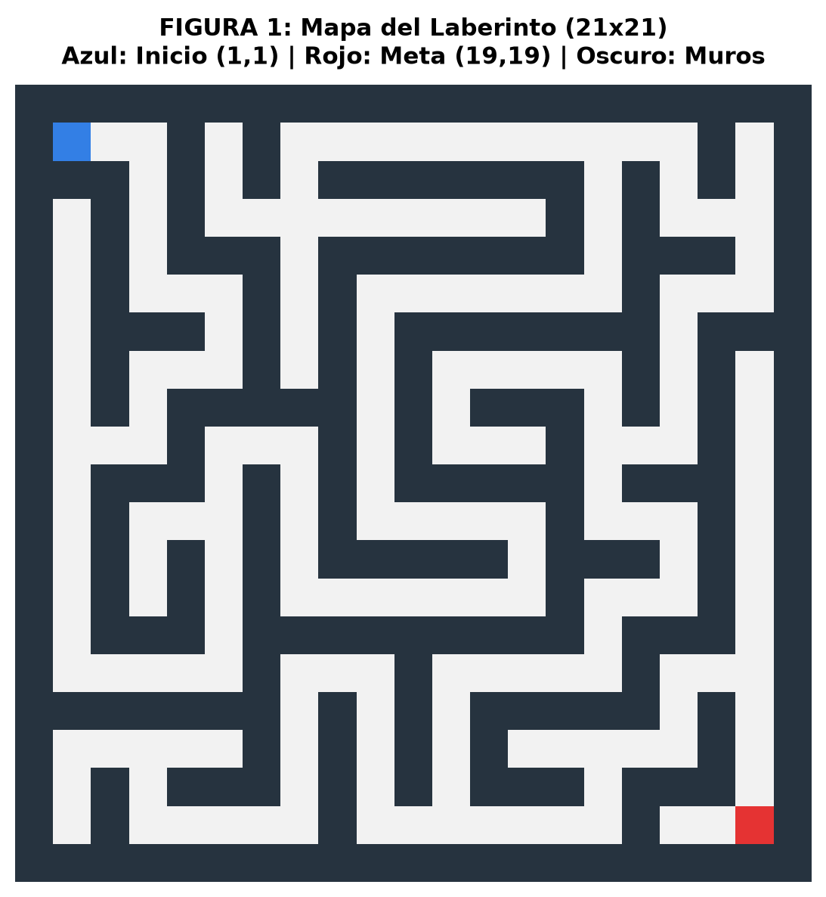
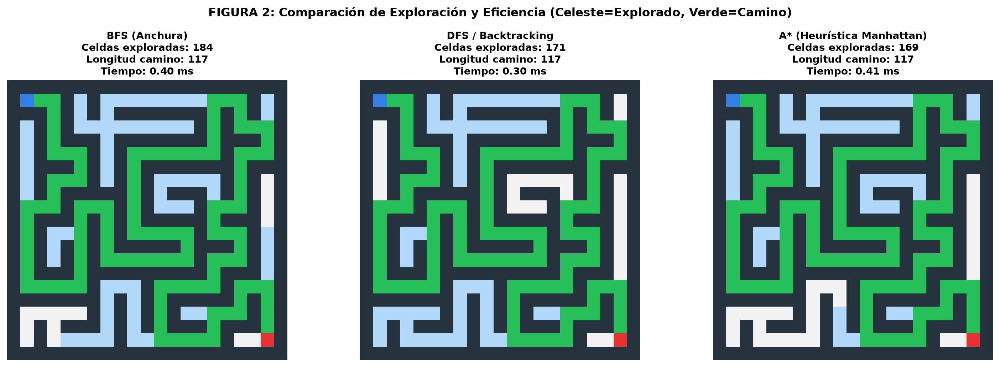
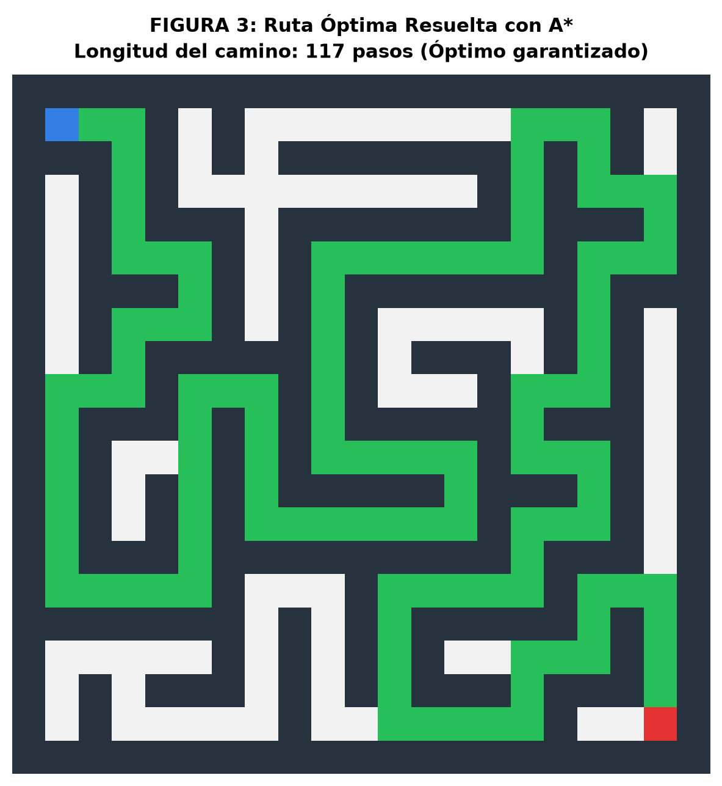
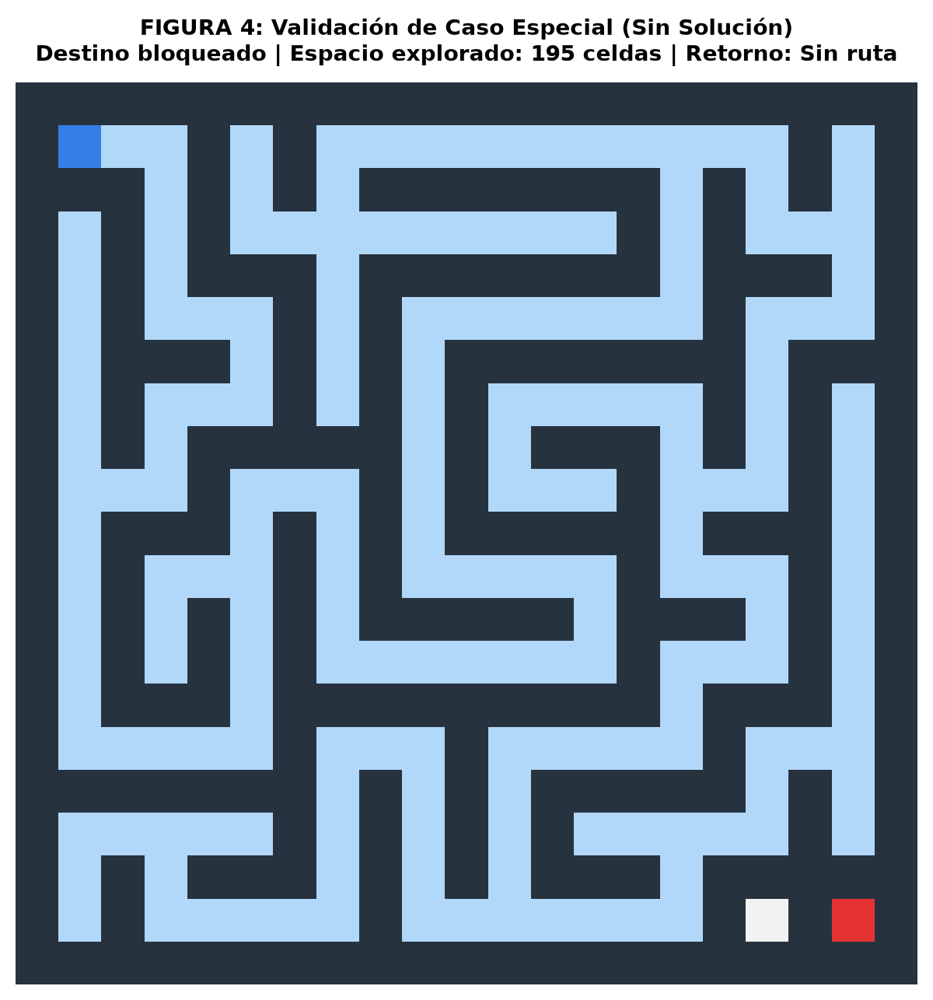

# 🧩 Maze Solver: Análisis Comparativo de Algoritmos de Búsqueda

Implementación, visualización y evaluación experimental de estrategias de búsqueda sobre grafos de cuadrícula bidimensionales ($N \times M$): **BFS**, **DFS con Vuelta Atrás (Backtracking)** y **A\*** con heurística Manhattan.

---

## 📌 Algoritmos Implementados

| Algoritmo | Tipo de Búsqueda | Estructura de Datos | Garantía de Ruta Óptima | Complejidad Temporal | Complejidad Espacial |
| :--- | :--- | :--- | :---: | :---: | :---: |
| **BFS** (Breadth-First Search) | Ciega / Nivel por nivel | Cola FIFO (`deque`) |  **Sí** (No ponderado) | $\mathcal{O}(V + E)$ | $\mathcal{O}(V)$ |
| **DFS** (Depth-First Search) | Ciega / Exhaustiva | Pila LIFO (`list`) | ❌ No | $\mathcal{O}(V + E)$ | $\mathcal{O}(V)$ |
| **A\*** (A-Star Search) | Informada / Heurística | Min-Heap (`heapq`) |  **Sí** (Heurística admisible) | $\mathcal{O}((V + E) \log V)$ | $\mathcal{O}(V)$ |

> **Heurística de A\***: Distancia Manhattan $h(r, c) = |r - r_{meta}| + |c - c_{meta}|$, la cual es monótona y admisible en cuadrículas 4-conexas sin movimientos diagonales.

---

## 🖼️ Demostración Visual

### 1. Laberinto de Entrada y Topología
Representación del entorno matricial con punto de inicio $(S)$ en verde, meta $(E)$ en rojo y paredes en gris oscuro.



### 2. Comparación del Espacio de Búsqueda
Contraste entre los nodos visitados (azul claro) y el camino solución encontrado (rojo) por cada estrategia:



* **BFS**: Explora uniformemente en círculos concéntricos hasta encontrar la salida.
* **DFS**: Penetra profundamente en ramas no óptimas, explorando casi la totalidad de pasadizos antes de retroceder.
* **A\***: Poda el espacio de búsqueda dirigiéndose directamente hacia el objetivo mediante la heurística Manhattan.

### 3. Ruta Óptima y Caso Especial sin Solución
Visualización de la ruta final y el comportamiento controlado del sistema cuando el destino es inaccesible:

| Ruta Óptima Obtenida (A*) | Caso Especial: Destino Bloqueado |
| :---: | :---: |
|  |  |

---

## 🚀 Instalación y Uso

### Prerrequisitos
- Python 3.10 o superior

### Instalación de dependencias
Clona el repositorio e instala los paquetes necesarios:

```bash
git clone https://github.com/TU_USUARIO/ProyectoFinal-ResolvedorLaberintos.git
cd ProyectoFinal-ResolvedorLaberintos
pip install -r requirements.txt
```

### Ejecución Básica
Para resolver el laberinto predeterminado en consola y ver el resumen de nodos visitados y longitud de ruta:

```bash
python maze_solver.py
```

### Ejecutar Benchmarks y Regenerar Figuras
Para ejecutar las pruebas de rendimiento en escenarios pequeño ($11 \times 11$), mediano ($25 \times 25$) y grande ($51 \times 51$) y actualizar las figuras:

```bash
python generate_visuals.py
```

---

## 📊 Estructura del Repositorio

```text
├── maze_solver.py                 # Clase Maze y algoritmos BFS, DFS, A*
├── generate_visuals.py            # Generación de visualizaciones y benchmarking
├── benchmark_results.txt          # Métricas de tiempo, longitud y nodos explorados
├── requirements.txt               # Dependencias del proyecto
├── README.md                      # Documentación del proyecto
├── fig1_entrada_laberinto.png     # Figura: mapa base del laberinto
├── fig2_proceso_comparacion.png   # Figura: comparación de exploración
├── fig3_resultado_optimo.png      # Figura: ruta óptima
└── fig4_caso_especial_sin_solucion.png # Figura: caso sin solución
```
